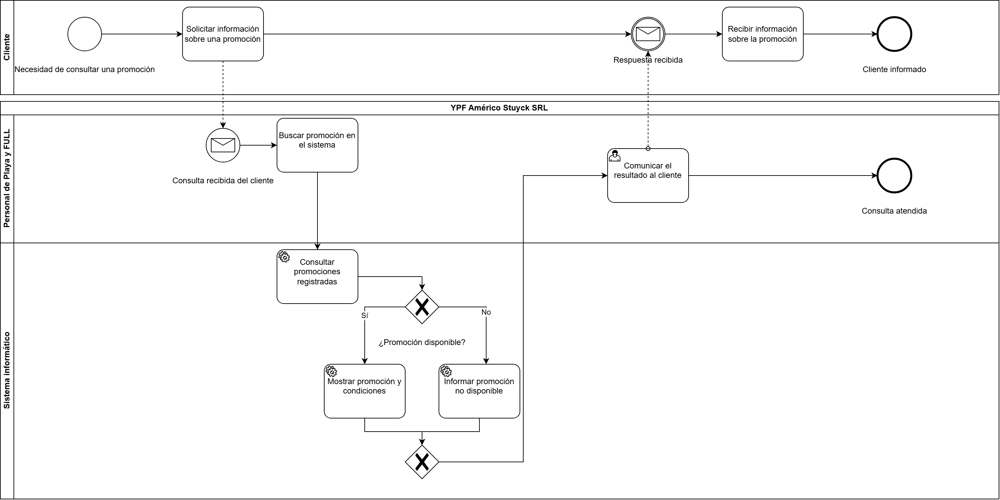

# Trabajo Práctico Integrador – Organización Empresarial

**Institución:** Universidad Tecnológica Nacional (UTN)  
**Empresa analizada:** YPF Américo Stuyck SRL  
**Proyecto:** Sistema informático de apoyo a la gestión empresarial

## 1. Descripción del proyecto

El presente Trabajo Práctico Integrador tiene como objetivo analizar la organización y proponer una solución informática que contribuya a mejorar la gestión de determinados procesos de YPF Américo Stuyck SRL.

El proyecto integra conceptos de estructura organizacional, procesos empresariales, diseño de datos, trabajo colaborativo y mecanismos de control.

## 2. Objetivo del sistema

Proponer un sistema informático que permita organizar y consultar información relevante para las actividades de la empresa, facilitando el acceso a los datos y apoyando las tareas del personal.

## 3. Proceso de negocio modelado mediante BPMN

Para la cuarta entrega se seleccionó el proceso **Consulta de promociones**.

Este proceso representa cómo un cliente solicita información sobre una promoción y cómo el personal de Playa y FULL utiliza el sistema informático propuesto para responder a esa consulta.

### Participantes

- **Cliente:** solicita y recibe información sobre las promociones.
- **Personal de Playa y FULL:** atiende la consulta y comunica el resultado.
- **Sistema informático:** consulta las promociones registradas y determina su disponibilidad.

### Descripción del proceso

1. El cliente solicita información sobre una promoción.
2. El personal recibe la consulta y busca la promoción en el sistema.
3. El sistema consulta las promociones registradas.
4. Se verifica si la promoción está disponible.
5. Si está disponible, el sistema muestra la promoción y sus condiciones.
6. Si no está disponible, informa esa situación.
7. El personal comunica el resultado al cliente.
8. El cliente recibe la información y finaliza la consulta.

### Diagrama BPMN

[Consultar archivo editable del BPMN](BPMN_Consulta_Promociones_YPF.drawio)

## 4. Herramientas utilizadas

- **diagrams.net:** elaboración del diagrama BPMN 2.0.
- **Git:** control de versiones del proyecto.
- **GitHub:** almacenamiento y seguimiento de la documentación.
- **GitHub Projects:** organización de tareas y seguimiento del avance del proyecto.

## 5. Trabajo colaborativo y control de versiones

El proyecto utiliza un repositorio público de GitHub para conservar su documentación y registrar las modificaciones realizadas.

Se emplean ramas de trabajo, commits descriptivos y Pull Requests para organizar e integrar los cambios.

## 6. Estado del proyecto

El proyecto se encuentra en la etapa de documentación y organización correspondiente a la cuarta entrega del Trabajo Práctico Integrador.

El sistema informático constituye una propuesta académica y no una aplicación implementada.
